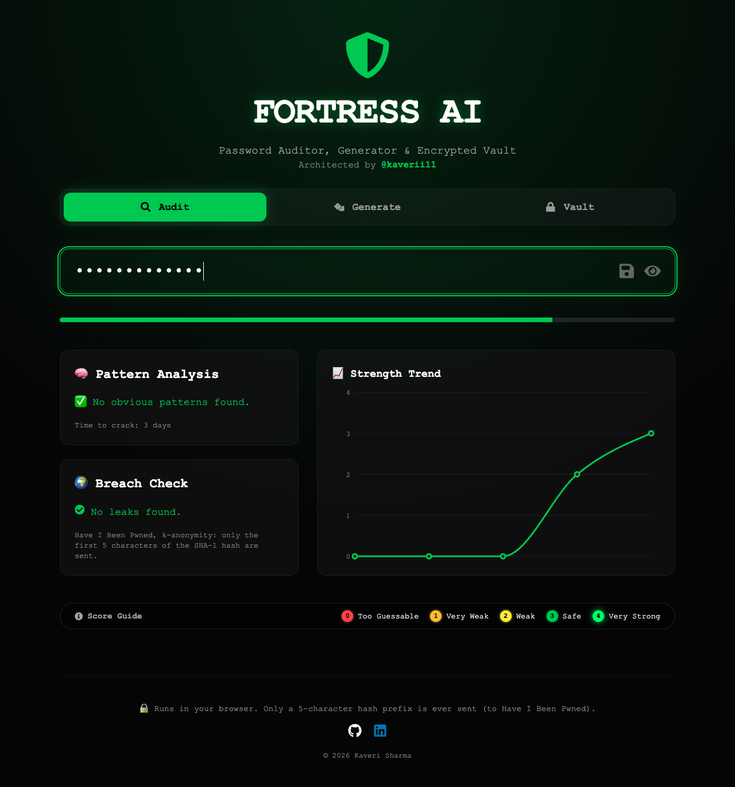
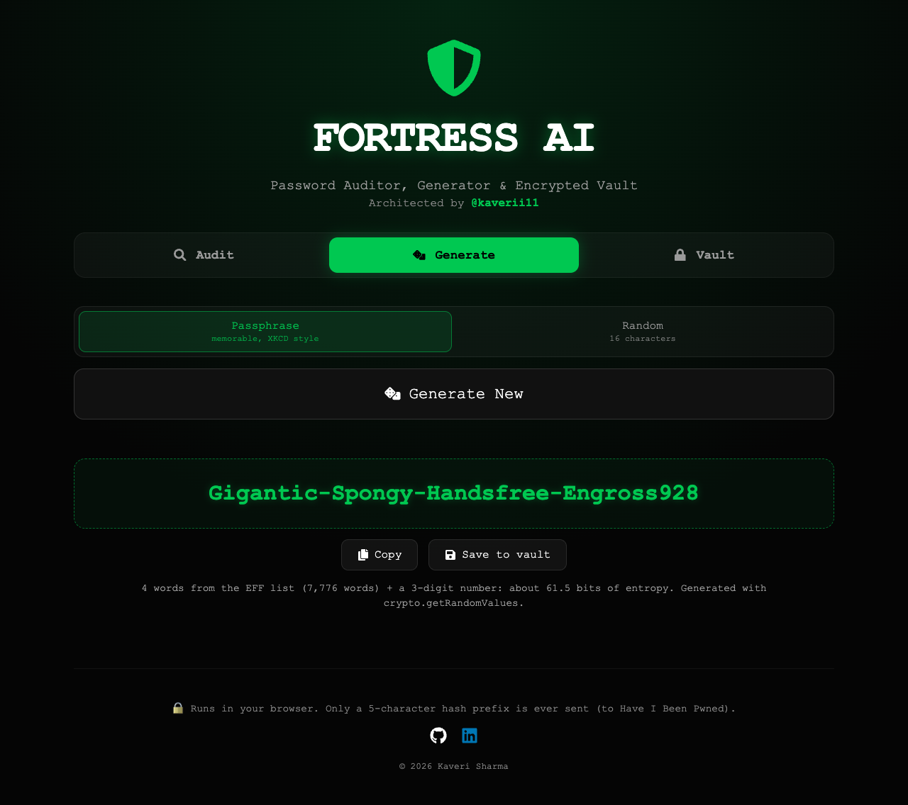
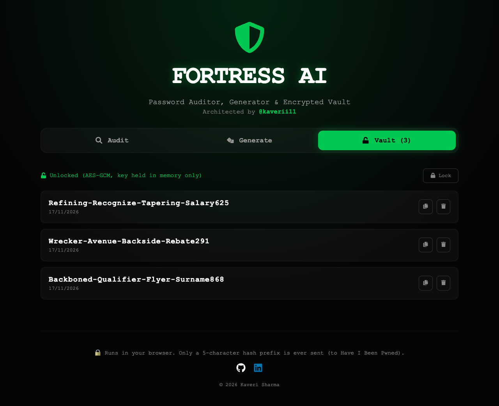
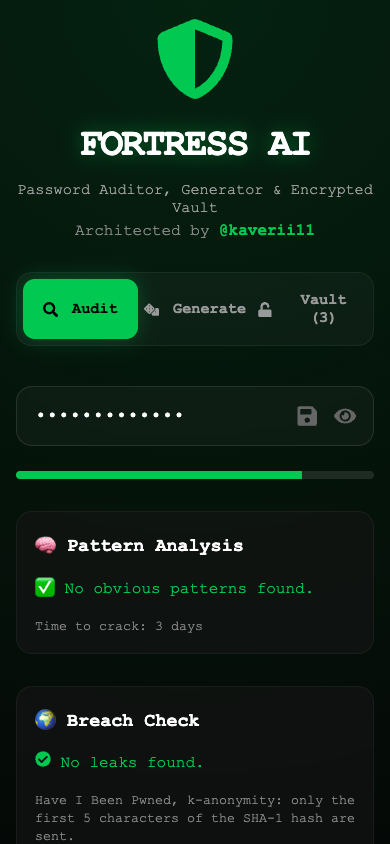

# 🛡️ Fortress - Password Auditor, Generator & Encrypted Vault


**Fortress** is a browser-only password security dashboard. It scores passwords for human patterns,
checks them against known breaches without sending the password anywhere, generates strong passwords
from a cryptographically secure random source, and keeps saved passwords in an **encrypted** local vault.

🔴 **Live demo:** [https://fortress-password-auditor.vercel.app](https://fortress-password-auditor.vercel.app)

---

## 📸 Interface

<p align="center">
  

  
  
</p>

<p align="center"></p>

---

## 🔐 Features

### 1. Pattern analysis
* Uses **[zxcvbn](https://github.com/dropbox/zxcvbn)** (Dropbox's strength estimator) to spot keyboard walks (`qwerty`),
  l33t substitutions (`P@ssw0rd`), dates, repeats and common words.
* Scores **0-4** and shows an estimated offline crack time (slow hash, 10k guesses/s).
* Runs 500 ms after you stop typing (debounced).

### 2. Strength trend
* A **Recharts** line chart of your last 10 scores, so you can see a password get stronger as you edit it.

### 3. Breach check (k-anonymity)
* Checks the password against **Have I Been Pwned's Pwned Passwords** list of leaked passwords.
* The password is hashed with **SHA-1** in the browser; **only the first 5 hex characters** of the hash are sent.
  The API returns every leaked hash with that prefix, and the match is done locally.
* The password itself never leaves the device.

### 4. Generator
* **Passphrase mode:** 4 words from the **EFF large wordlist (7,776 words)** + a 3-digit number,
  e.g. `Corral-Unclasp-Purifier-Nebula925`. 4 × log2(7776) + log2(900) ≈ **61.5 bits** of entropy.
* **Random mode:** 16 characters from a 70-character set. 16 × log2(70) ≈ **98.1 bits**.
* All randomness comes from **`crypto.getRandomValues`**, with rejection sampling so every word and character is equally likely.

### 5. Encrypted vault
* Saved passwords are encrypted with **AES-GCM (256-bit)** before they touch `localStorage`.
* The key is derived from a **master password** with **PBKDF2-SHA256, 600,000 iterations** and a random 16-byte salt.
* Every save uses a fresh random 12-byte IV. Only `{version, kdf, iterations, salt, iv, ciphertext}` is stored.
* The master password is never stored. The derived key is **non-extractable** and lives only in memory
  while the vault is unlocked; **Lock** or a page reload forgets it.
* A wrong password (or edited ciphertext) fails AES-GCM's authentication check and shows an error.
* Vaults from older versions (plain JSON under `fortressVault`) are encrypted on first unlock and the plain copy is deleted.

---

## 🧱 Security design

| Concern | What Fortress does |
|---|---|
| Password sent to a server | Never. Only a 5-character SHA-1 prefix goes to `api.pwnedpasswords.com`. |
| Why SHA-1? | It's what the Pwned Passwords range API uses. It is only used for this lookup, not for storage. |
| Vault at rest | AES-GCM-256 ciphertext; key from PBKDF2-SHA256 (600k iterations, per-vault salt). |
| Key handling | Web Crypto `CryptoKey`, non-extractable, memory only. |
| Random numbers | `crypto.getRandomValues` + rejection sampling (no `Math.random`). |

Code: [`src/utils/vaultCrypto.js`](src/utils/vaultCrypto.js), [`src/utils/secureRandom.js`](src/utils/secureRandom.js),
[`src/utils/PasswordLogic.js`](src/utils/PasswordLogic.js).

### Limitations
* While the vault is **unlocked**, its contents are in page memory; malicious script on the page (XSS, a bad extension) could read them.
* The vault is per-browser: no sync, no backup, and **no recovery** if you forget the master password.
* A weak master password can still be brute-forced offline by someone who copies the ciphertext; PBKDF2 only slows that down.
* The breach check needs network access to Have I Been Pwned; if it fails, the app says the check is unavailable.
* zxcvbn's crack time is an estimate, not a guarantee.

---

## 🛠️ Tech stack

* **Frontend:** React 19 + Vite
* **Crypto:** Web Crypto API (AES-GCM, PBKDF2, SHA-1 for HIBP, `getRandomValues`)
* **Analysis:** zxcvbn
* **Charts:** Recharts
* **Styling:** CSS (glassmorphism, responsive grid)

---

## 🚀 Run locally

```bash
git clone https://github.com/kaverii11/fortress-password-auditor.git
cd fortress-password-auditor
npm install
npm run dev      # http://localhost:5173
npm run build    # production build in dist/
```

---

Word list: [EFF Large Wordlist](https://www.eff.org/dice) by the Electronic Frontier Foundation (CC BY 3.0 US).
